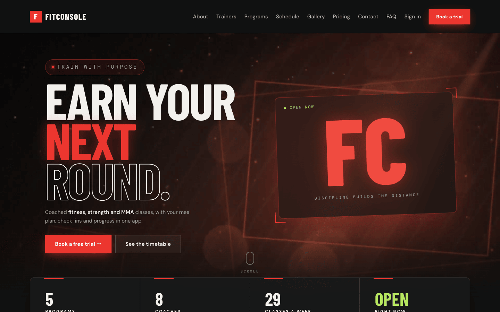
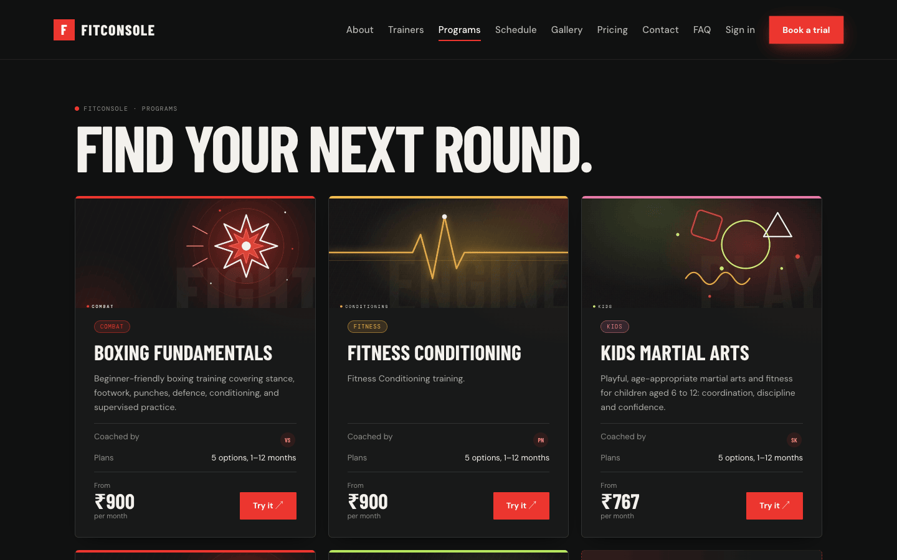
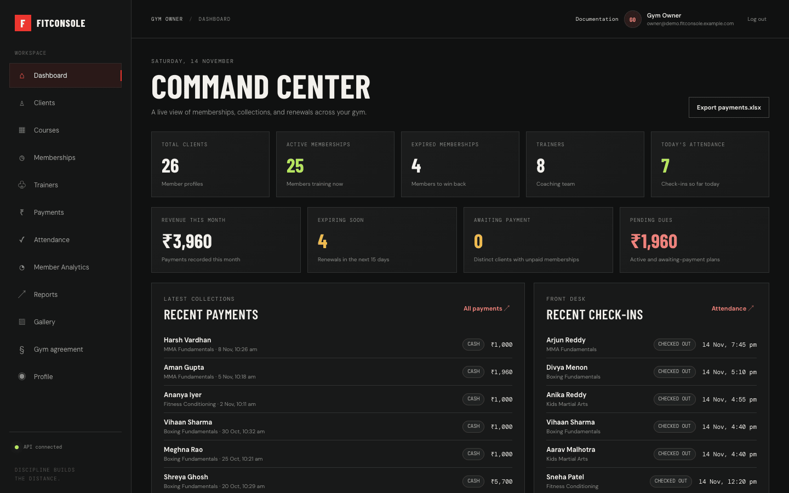
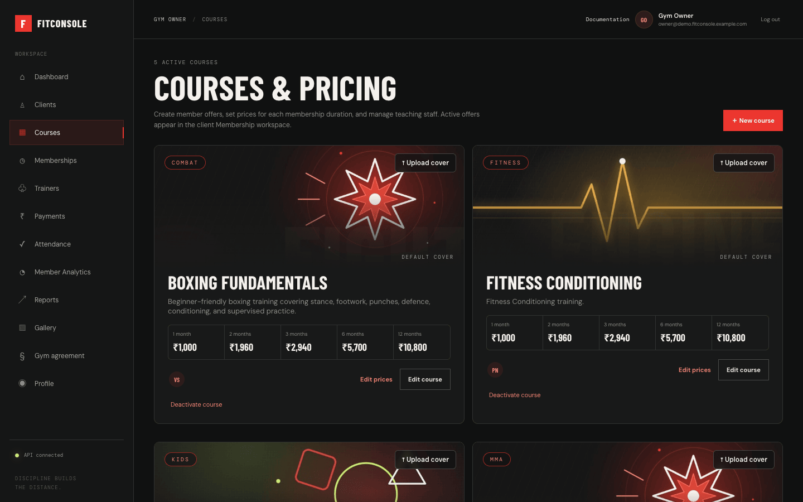
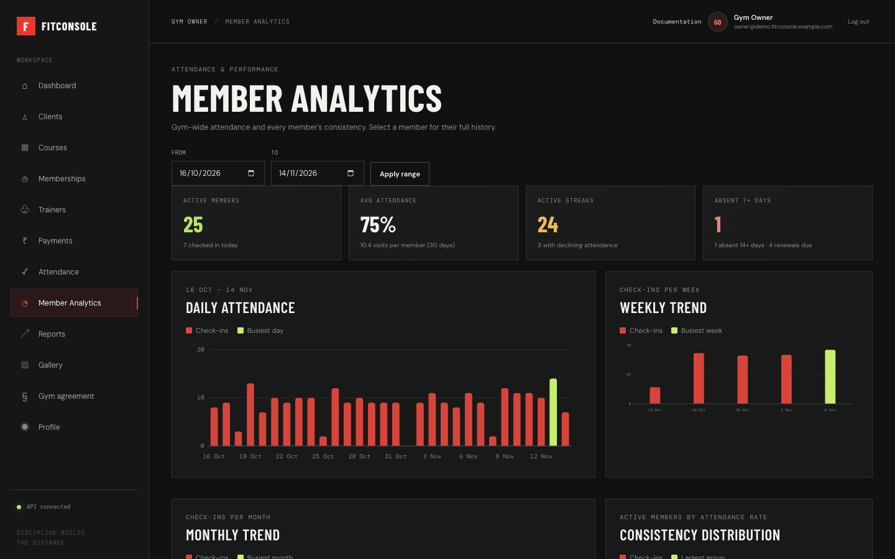
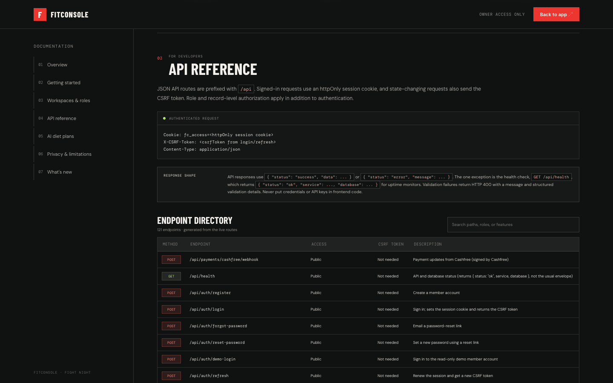
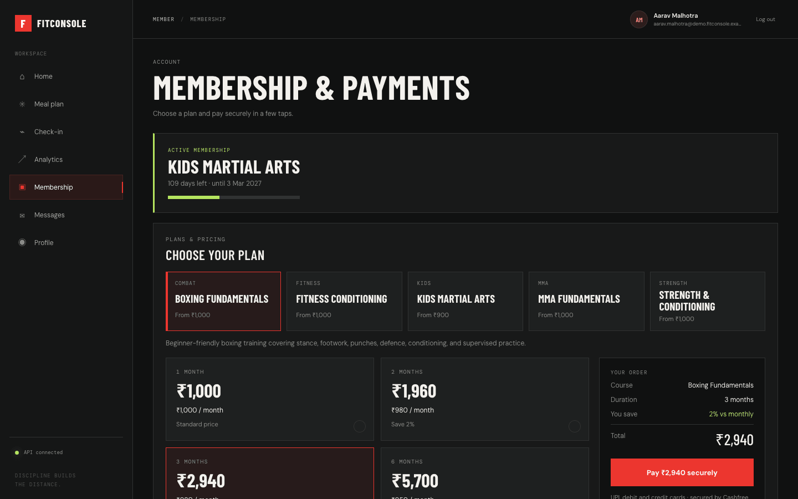

# FitConsole

[](https://github.com/RajLaxmiSingh22/FitConsole/actions/workflows/ci.yml) [](LICENSE)

**Live demo:** _coming soon_. The link will be added here once the app is deployed (see [Deployment](#deployment)).

FitConsole is a full-stack gym management application for owners, trainers, and clients. It brings course and membership administration, attendance, payments, trainer-reviewed diet plans, and member communication into one web application.

The repository contains two independent JavaScript projects: an Express API and a React web client. They have separate dependency manifests and lockfiles; there is no root npm workspace or Docker setup.

## Features

- Role-based owner, trainer, and client accounts with secure cookie sessions with CSRF protection.
- Client and trainer profiles, trainer assignment, configurable courses, and 1-, 2-, 3-, 6-, and 12-month course plans.
- Membership enrollment and renewal, manual payment records, and Cashfree checkout with server-side payment verification before recording a successful payment.
- Attendance check-ins and client attendance history.
- Client diet and progress tracking; optional Gemini-generated diet-plan drafts that trainers can review and approve.
- Waiver display and acceptance records, participant-limited messaging, owner/trainer dashboards, and owner XLSX exports.
- Owner, trainer, and client workspaces in the React application.
- Responsive public website routes, consent-based first-party analytics, and free-trial booking requests.
- Owner-only website lead management with activity history, trial status tracking, and eligible lead-to-member conversion.
- Rate-limited password-reset requests with hashed, expiring, single-use reset tokens and SMTP email delivery (for example Gmail).

## Screenshots

| | |
| --- | --- |
|  |  |
| Public home page: animated hero and "Open now" status | Programs: one card style, aligned prices, free-trial card |
|  |  |
| Owner dashboard: members, payments and check-ins | Courses: covers, prices by duration, coaches |
|  |  |
| Member analytics: red bars, busiest bar in lime | Owner documentation: endpoint directory generated from the routes |
|  | |
| Member: choosing a plan and paying | |

Screenshots use the fictional demo gym data from `npm run seed:demo-gym`.

## Architecture and technology

| Area | Technologies |
| --- | --- |
| Frontend | React, Vite, Cashfree browser SDK |
| Backend | Node.js, Express, Joi, Argon2, signed httpOnly session cookies with CSRF protection |
| Persistence | PostgreSQL, Sequelize |
| Optional integrations | Cashfree Payments, Google Gemini, SMTP email (Nodemailer), ExcelJS |

The API owns authorization, validation, membership pricing, payment order creation, and payment verification. The frontend does not receive Cashfree's server secret. Cashfree payments are recorded from the return-to-app status fetch, the signed webhook, and the daily reconciliation job.

## Requirements

- Node.js 20 or newer and npm.
- PostgreSQL 14 or newer, running locally or reachable from the backend.

## Local setup

### 1. Create a PostgreSQL database

For example, connect to PostgreSQL as an administrator and create a dedicated local user and database:

```sql
CREATE USER fitconsole WITH PASSWORD 'replace_with_a_local_password';
CREATE DATABASE fitconsole OWNER fitconsole;
```

### 2. Configure and start the backend

```sh
cd Backend
npm ci
cp .env.example .env
```

Edit `Backend/.env` before starting. Set `DB_NAME`, `DB_USER`, and `DB_PASSWORD` for the database above; set `JWT_SECRET` to a private random value of at least 32 characters; and configure the owner bootstrap account. Trainer bootstrap accounts are optional; trainers can also be created later from the owner workspace. Bootstrap passwords must be 12–128 characters. Existing accounts are not overwritten on server startup, so changing a bootstrap password does not reset an account password. The example deliberately contains placeholders and is not ready to run unchanged.

The server defaults to port `9000` and CORS origin `http://localhost:5173`.

```sh
npm run migrate
npm run dev
```

The API health endpoint is <http://localhost:9000/api/health>.
The migration command applies the versioned SQL migrations in `Backend/db/migrations/`; server startup does the same. A new database is created from `202610290000_baseline.sql`, which contains the full schema. A database that already applied the 13 earlier migrations just records the baseline as applied. A database that applied only some of them is refused: upgrade it with commit `a59d7ee` first. Schema changes go in new, later-dated migration files; models are not synchronized with `sequelize.sync()`. Review migration SQL and use a backed-up non-production database before first application.

### 3. Configure and start the frontend

In another terminal:

```sh
cd Frontend
npm ci
cp .env.example .env
npm run dev
```

Open <http://localhost:5173>. `VITE_API_URL` should point to the backend API base URL, including `/api`; the local default is `http://localhost:9000/api`. Keep the frontend Cashfree mode aligned with the backend environment.

## Environment variables

`Backend/.env.example` lists the backend settings. Replace all `REPLACE_...` placeholders and keep the resulting `.env` file private.

| Variable | Purpose |
| --- | --- |
| `DB_NAME`, `DB_USER`, `DB_PASSWORD` | Required PostgreSQL database and credentials. |
| `DB_HOST`, `DB_PORT` | PostgreSQL address; defaults are `localhost` and `5432`. |
| `JWT_SECRET` | Required private signing secret, at least 32 characters. |
| `FRONTEND_PUBLIC_URL` | Public frontend origin used in password reset links. Production must use HTTPS. |
| `SMTP_HOST`, `SMTP_PORT`, `SMTP_USER`, `SMTP_PASSWORD`, `EMAIL_FROM` | Optional SMTP email (e.g. Gmail with an App password). Required for password reset; also sends welcome, sign-in alert, password-changed and membership-ending (7 days and 1 day before) emails. Links use `FRONTEND_PUBLIC_URL`. |
| `OWNER_EMAIL`, `OWNER_PASSWORD` | Required owner bootstrap account; `OWNER_NAME` is optional. |
| `TRAINER_1_*`, `TRAINER_2_*`, `TRAINER_3_*` | Optional trainer bootstrap names, unique emails, and passwords; configure all three fields for each used slot. |
| `PORT`, `CORS_ORIGIN` | API port and allowed frontend origin; defaults are `9000` and `http://localhost:5173`. |
| `TRUST_PROXY_HOPS` | Number of trusted reverse-proxy hops used for client IP rate limits; default `0`. Configure only for the actual deployment topology. |
| `TRIAL_BOOKING_DUPLICATE_WINDOW_HOURS` | Rolling per-phone trial booking duplicate window; default `24`. |
| `CASHFREE_APP_ID`, `CASHFREE_SECRET_KEY` | Optional Cashfree credentials; the secret belongs only in the backend environment. |
| `CASHFREE_ENVIRONMENT`, `CASHFREE_RETURN_URL` | Cashfree mode (`sandbox` or `production`) and frontend return URL. |
| `GEMINI_API_KEY`, `GEMINI_MODEL` | Optional Gemini credentials/model for diet-plan generation. Both are required to enable it; there is no default model. |
| `GST_RATE` | GST percent used by `gst.xlsx` (default 18, 0–28). |
| `RUN_JOBS` | `true` on exactly one instance to run the daily maintenance job. |
| `WAIVER_VERSION`, `WAIVER_TEXT` | Waiver version and text. Supply reviewed, non-empty text before collecting acceptance. |

The frontend template contains `VITE_API_URL` and `VITE_CASHFREE_MODE`. Only use public configuration in `VITE_` variables; frontend build variables are visible to browser users.

The owner bootstrap account is created only when it does not already exist. Optional trainer bootstrap accounts are also created only once; server restarts do not replace existing account passwords or deactivate accounts. Use the owner workspace to create and manage trainer accounts.

## API overview

All routes are prefixed with `/api`. Sessions use httpOnly cookies: `POST /auth/login` sets a 15-minute access cookie and a 7-day rotating refresh cookie, `POST /auth/refresh` rotates them, and `POST /auth/logout` revokes them. State-changing requests must send the `csrfToken` returned by login/refresh in an `X-CSRF-Token` header. List endpoints for clients, payments, memberships, and attendance accept `?page=&limit=` (max 100) and then return `{ items, pagination }`.

| Area | Representative routes |
| --- | --- |
| Authentication | `POST /auth/register`, `POST /auth/login`, `POST /auth/forgot-password`, `POST /auth/reset-password`, `GET /auth/me`, `PATCH /auth/password` |
| Users | Owner: `POST /users/trainers`, `GET /users?role=...`, `PATCH /users/:id/status` |
| Clients | `GET/PATCH /clients/me`, owner: `GET/POST /clients`, `GET/PATCH /clients/:id`, `PATCH /clients/:id/trainer`, `PUT /clients/:id/id-proof` |
| Trainers | `GET /trainers`, `GET /trainers/:id`, `PATCH /trainers/me`, owner: `PATCH /trainers/:id`, `GET /trainers/me/clients` |
| Courses | `GET /courses`, `GET /courses/:id`; owner can create, update, delete, set prices, and assign trainers. |
| Memberships | Owner: `GET/POST /memberships`; client: `POST /memberships/checkout`; renew with `PATCH /memberships/:id/renew`, cancel with `PATCH /memberships/:id/cancel`; history at `/clients/:id/memberships`. |
| Payments | Owner: `GET/POST /payments`, `GET /payments/reminders`, `PATCH /payments/reminders/:paymentId/resolve`, `PATCH /payments/:id`; Cashfree order creation at `POST /payments/cashfree/orders`, verification at `GET /payments/cashfree/orders/:orderId`, and public webhook receiver at `POST /payments/cashfree/webhook` (Cashfree signature verification required). Configure `https://YOUR_API_HOST/api/payments/cashfree/webhook` in the Cashfree dashboard for payment success events. |
| Waivers and attendance | `GET /waivers/current`, client `POST /waivers/accept`, owner/trainer check-in and attendance-list routes, and client attendance history. |
| Diet | Diet entries and summaries under `/clients/:id/diet-entries`; weekly progress at `GET/POST /clients/:id/progress`; trainer plan generation at `POST /clients/:id/diet-plans/generate`, weekly revision at `POST /clients/:id/diet-plans/:planId/suggest-tweak`, and approval routes. Calorie and macro targets are computed on the server (Mifflin-St Jeor) and Gemini output is schema-validated and must land within 10% of the target. |
| Messaging | `GET/POST /conversations` and `GET/POST /conversations/:id/messages`. |
| Dashboards and reports | `GET /dashboard/owner`, `GET /dashboard/owner/analytics?from&to` (IST dates, max 366 days), `GET /dashboard/trainer`, and owner XLSX exports: `payments`, `clients`, and `course-revenue`, `gst`, `dues`, `attendance` (these four take `?from&to`). Owners can prepare WhatsApp payment reminders with `POST /payments/reminders/:paymentId/send` (one per member per 24 hours). |
| Public lead capture | `POST /public/trial-bookings` creates an unconfirmed request from a real active course; repeated phone submissions are blocked during the configured window. |
| Lead management | Owner-only `GET /leads`, `GET /leads/:id`, `PATCH /leads/:id/status`, `PATCH /leads/:id/course`, `POST /leads/:id/notes`, and `POST /leads/:id/enroll`. Enrollment requires recorded trial attendance, an active assigned course, and an existing matching member account. |
| Website analytics | Consent-gated `POST /public/events`; owner-only `GET /analytics/summary?from=&to=`. Visits are distinct consented sessions; conversion rates use same-period lead cohorts and return `null` for a zero denominator. |

The backend validates request bodies, query parameters, and route IDs using Joi schemas. Public registration creates client accounts; owner and trainer accounts are provisioned from backend configuration. ID-proof and signed-document values are file references only; upload and secure file storage are not implemented. Lead conversion links an existing matching client/member profile and does not create an account or record a payment on that person's behalf.

For full request validation schemas and route definitions, see `Backend/src/validation/` and `Backend/src/routes/`.

## Tests and production build

Backend unit tests:

```sh
cd Backend
npm test
```

Frontend production build:

```sh
cd Frontend
npm run build
```

The frontend currently has no test or lint script. Backend tests cover selected helpers, configuration, and validation; they do not provide comprehensive HTTP, database, authorization, or payment-provider integration coverage.

## Deployment

### Frontend and API must share one site

Sessions use `SameSite=Strict` cookies, so the browser only sends them when the page and the API belong to the **same site** (the same registrable domain). Host them as two subdomains of one domain you own:

| Part | Example | Notes |
| --- | --- | --- |
| Frontend (static files from `Frontend/dist`) | `https://app.example.com` | Built with `VITE_API_URL=https://api.example.com/api` |
| API (`node src/server.js`) | `https://api.example.com` | Behind HTTPS (a reverse proxy or the host's load balancer) |

Do **not** put the frontend and API on two different hosting domains (for example `myapp.vercel.app` and `myapi.onrender.com`): those are different sites, the session cookie is never sent, and every signed-in request fails with 401. Serving both from one domain (for example `example.com` for the app and `example.com/api` through a proxy) also works.

### Production settings

Set these in the API's environment (see `Backend/.env.example` for the full list):

| Variable | Production value | Why |
| --- | --- | --- |
| `NODE_ENV` | `production` | Turns on production checks (HTTPS links, secure cookies by default). |
| `COOKIE_SECURE` | `true` (default in production) | Cookies are only sent over HTTPS. Never set `false` in production. |
| `CORS_ORIGIN` | `https://app.example.com` | The exact frontend origin(s), comma-separated; credentials are only accepted from these. |
| `TRUST_PROXY_HOPS` | `1` behind one reverse proxy / load balancer (0–5) | Lets the API see the real client IP and HTTPS for rate limits and secure cookies. Leave `0` when nothing sits in front of Node. |
| `FRONTEND_PUBLIC_URL` | `https://app.example.com` | Links in emails (password reset, reminders); must be HTTPS in production. |
| `CASHFREE_RETURN_URL` | `https://app.example.com/` | Where Cashfree sends members back after paying. |
| `JWT_SECRET` | A long random secret (32+ characters) | Signs session cookies; changing it signs everyone out. |
| `DB_HOST`, `DB_PORT`, `DB_NAME`, `DB_USER`, `DB_PASSWORD` | Your PostgreSQL | Migrations run automatically on start. |
| `OWNER_EMAIL`, `OWNER_PASSWORD` | The owner account | Provisioned on start. |
| `RUN_JOBS` | `true` on one instance | Daily reconciliation and reminder emails. |
| `CLOUDINARY_URL`, `SMTP_*`, `CASHFREE_*`, `GEMINI_*` | Optional integrations | Each feature is switched off when its settings are missing. |

Build the frontend with the API URL baked in:

```sh
cd Frontend && VITE_API_URL=https://api.example.com/api VITE_CASHFREE_MODE=production npm run build
```

Note that public rate limits are kept in memory per process; run one API instance (or add a shared store) before scaling out.

## Current limitations and release considerations

- The schema is migration-only, starting from the 2026-10-29 baseline. Databases created before the first versioned migration (by `sequelize.sync()` alone) must be upgraded with commit `a59d7ee` before this release. Run migrations against a backup or staging database first.
- Public endpoint throttling is in-memory and per application process. Use a shared rate-limit store before deploying multiple backend replicas.
- Password reset requires SMTP settings and `FRONTEND_PUBLIC_URL`; reset is unavailable until configured. Do not enable it in production with an HTTP URL. Gmail SMTP has daily sending limits; use a transactional email provider for larger member counts.
- Lead enrollment requires a member account already registered with the same phone or email. New-account invitation delivery and automated trial scheduling/confirmation are not implemented.
- The project has no branch, class-schedule, or gym-contact configuration model. Related public pages must disclose unavailable details instead of presenting invented hours, addresses, schedules, or contact information.
- Consent copy and privacy/legal text require review and approval for the operating jurisdiction before release. Analytics does not store IP addresses or device fingerprints.
- `npm start` currently runs the development watcher (`nodemon`). Use a production process command and migration strategy before deployment.
- The Vite development server binds to `0.0.0.0`; keep it on a trusted development network and do not use it as the production web server.
- Cashfree checkout is configured for sandbox by default. Production credentials and deployment settings require separate secure configuration and live-mode verification.
- Configure Cashfree's `PAYMENT_SUCCESS_WEBHOOK` event to send to `https://YOUR_API_HOST/api/payments/cashfree/webhook`. The endpoint accepts only recent signed JSON requests, acknowledges promptly, then re-fetches payment details from Cashfree before recording.
- Waiver acceptance records the configured version and acceptance time, but the application does not store a snapshot or hash of the exact displayed waiver text. Configure and review the waiver before use.
- Public trainer routes exclude private phone data; authenticated owners and the trainer themself can retrieve the phone field.
- Login, registration, password-reset, AI diet-plan generation, booking, and analytics endpoints have in-memory throttling. Login attempts are limited per IP/email, per IP, and per account. Throttling is in-memory per process. Session cookies are `SameSite=Strict`, so the frontend and API must share a registrable domain, and they are `Secure` in production (`COOKIE_SECURE=false` only for plain-HTTP local development).
- Set `RUN_JOBS=true` on exactly one instance to run the 00:05 gym-time job that expires memberships, cancels unpaid memberships older than 48 hours, reconciles stale Cashfree orders, and prunes expired sessions.
- Payment reminders are records for follow-up, not automated notifications. Messaging refreshes on demand rather than using live delivery.
- Owner-only documentation visibility is enforced in the frontend UI; do not treat UI gating as server-side confidentiality.
- Diet generation requires a valid Gemini API key. User-uploaded files, automated waiver-document storage, and route-level integration tests are not included.

## Repository layout

```text
Backend/
  src/
    config/           Bootstrap account configuration
    controllers/      API request handlers
    middleware/       Authentication, authorization, and validation
    models/           Sequelize models and associations
    routes/           Express route definitions
    services/         External service integrations
    validation/       Joi schemas
  test/               Node.js test-runner tests
Frontend/
  src/
    services/         API client, Cashfree checkout, analytics storage (data layer)
    hooks/            Data loading and session/navigation state (controller layer)
    pages/            Screens per area: public, auth, docs, owner, trainer, client, messages
    layouts/          Authenticated app shell
    components/       Shared UI (components/ui/) and reusable widgets
    constants/        Navigation, routes, option lists, static copy
    utils/            Formatting and date helpers
PROJECT_OVERVIEW.md   Current product scope and limitations
```

## Live demo account

The login page has an **Explore Live Demo** button that signs visitors into a shared sample member, "Alex Morgan", with about two months of history: membership, payments, attendance, progress, diet check-ins, an approved diet plan and coach messages.

1. In `Backend/.env` set `DEMO_MODE_ENABLED=true`, `DEMO_CLIENT_EMAIL` (default `demo.client@fitconsole.example.com`) and a long random `DEMO_CLIENT_PASSWORD`. The password stays on the server; the browser only calls `POST /api/auth/demo-login`.
2. Run `cd Backend && npm run seed:demo`. The seed is idempotent: it rebuilds only the demo account's own records relative to today, so re-run it any time to refresh the dates.
3. Restart the backend. To turn the demo off, set `DEMO_MODE_ENABLED=false` and restart; the endpoint then returns 404 and the button shows "not available".

The demo account is read-only on the server: every POST, PUT, PATCH and DELETE it sends is refused with `DEMO_READ_ONLY`, so visitors cannot edit data, send messages, change the password or start payments. Its password cannot be reset, it never receives emails, and as a client it cannot reach owner or trainer routes.

## Demo gym data

`cd Backend && npm run seed:demo-gym` builds a complete demo gym for testing every role. Set `DEMO_GYM_PASSWORD` (12+ characters) in `Backend/.env` first; it becomes the sign-in password for all demo coaches and members.

- 5 coaches (Boxing, MMA, Strength & Conditioning, Fitness & Weight Management, Kids) with bios, specialties, achievements and timetable slots.
- 2 new courses: Boxing Fundamentals (ages 8+) and Kids Martial Arts (ages 6–12), plus 1, 2, 3, 6 and 12-month plans on every course.
- 25 members, 5 of them under 13 with a guardian. Each has memberships, **cash** payments recorded by the owner, about three months of attendance with check-in and check-out times, weekly progress with measurements, wellness check-ins (adults) and trainer notes.

All demo accounts use `@demo.fitconsole.example.com` addresses, so no real inbox ever receives email. Re-running the seed rebuilds only those accounts' history relative to today; real accounts are never touched. `npm run seed:demo` refreshes the public demo member (Alex Morgan).

## Security

Never commit `.env` files, API keys, database credentials, tokens, private keys, database backups, private PDFs, or generated test artifacts. Use the reviewed `.env.example` templates as a starting point and rotate any credential that has been exposed.

`npm audit` reports no high or critical findings. Two moderate findings remain in `minimatch`, used only by the development file watcher `nodemon`; npm's suggested fix is a downgrade, so it was not applied.

## License

FitConsole is released under the [MIT License](LICENSE). Copyright (c) 2026 RajLaxmiSingh22.
